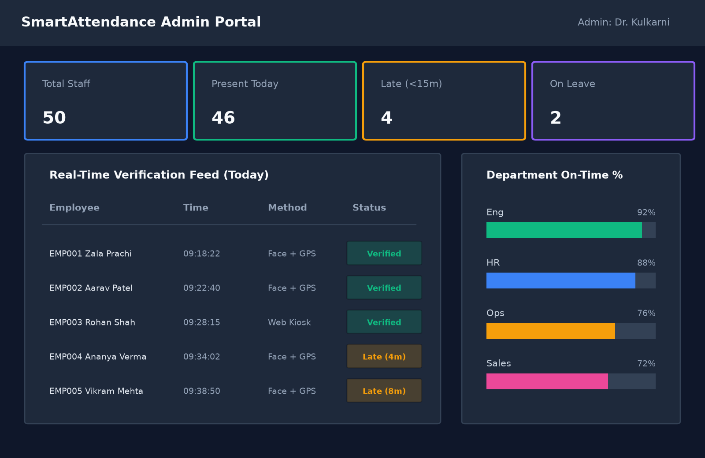
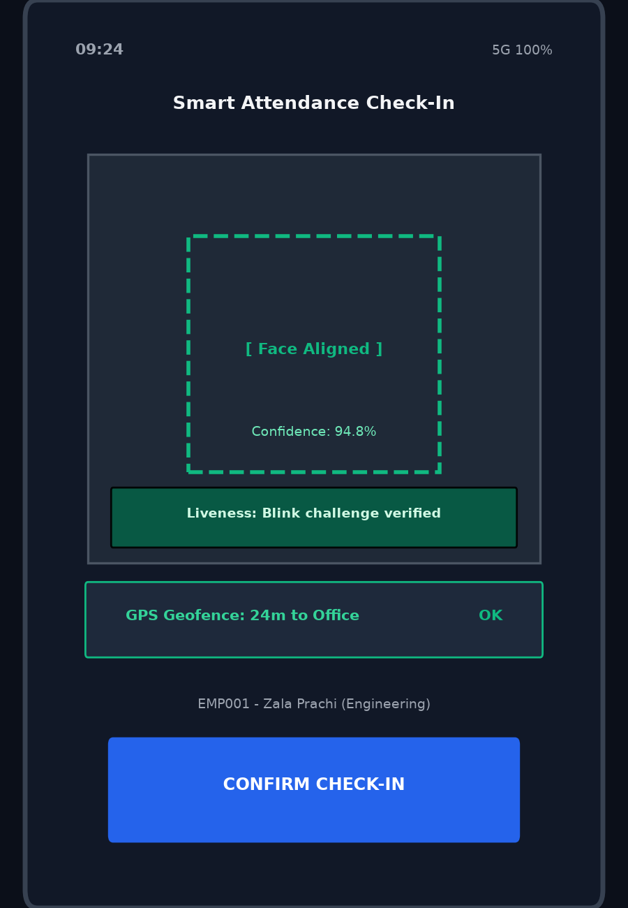
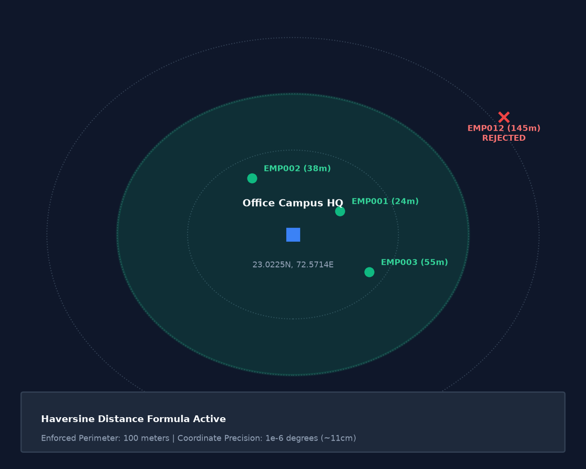
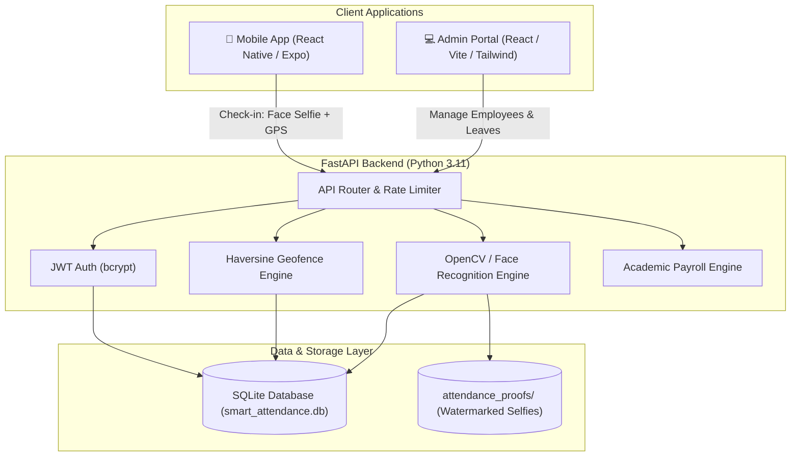

# AI Smart Attendance & Workforce Management System

[](https://github.com/prachizala/AI_Smart_Attendance_System/actions/workflows/ci.yml)
[](https://www.python.org/)
[](https://fastapi.tiangolo.com/)
[](https://react.dev/)
[](https://expo.dev/)
[](LICENSE)
[](https://github.com/prachizala/AI_Smart_Attendance_System/stargazers)

> ⭐ **If you find this minor project or facial-GPS attendance architecture helpful, please consider starring this repository!**

An academic, dual-factor attendance and workforce management platform combining **biometric facial verification (OpenCV)**, **GPS geofencing (Haversine formula)**, and an **interactive admin analytics portal**. Developed as an official BCA 5th Semester Minor Project (Academic Project) at Shanti Business School, Ahmedabad, Gujarat.

---

## 📱 Screenshots & Demo

| Admin Analytics Dashboard | Mobile Check-In & Camera | Geofence Perimeter Map |
| :---: | :---: | :---: |
|  |  |  |

> 📹 *A 60–90 second end-to-end demonstration GIF will be added to `docs/screenshots/demo.gif`.*

---

## 🏗️ System Architecture



---

## 🌟 Features

### Core Modules
* **Dual-Factor Check-In:**
  * **Gate 1 (WHERE):** GPS geofence validation via the Haversine formula against configurable campus coordinates (default: 100m radius).
  * **Gate 2 (WHO):** Facial feature comparison calculating Euclidean distance between live selfies and registered 128-d biometric embeddings.
* **Anti-Duplicate Guarantee:** Database-enforced rule preventing duplicate check-ins on the same calendar date (returns HTTP 409 Conflict).
* **Work Hours & Lateness Classification:** Automated status tagging (`present` vs `late`) against configurable shift start thresholds (default: `09:30 AM`).
* **Visual Audit Watermark:** Automatically burns employee ID, GPS coordinates, UTC timestamp, and confidence score onto punch photos.

### Extended Modules
* **Admin Analytics & Leave Management:** Real-time attendance dashboards, pending leave approvals, and employee profile directory.
* **Academic Payroll:** Gross-to-net salary computation factoring in late arrival penalties and approved leaves.
* **Anti-Screenshot QR Kiosk:** 15-second rotating HMAC-SHA256 tokens for kiosk check-in.
* **HR Assistant Chatbot:** Natural language queries for personal punctuality and leave balances.

> 📖 *For complete technical breakdowns of extended modules, see [`docs/FEATURES.md`](docs/FEATURES.md).*

---

## 🛠️ Technology Stack

| Domain | Technologies Used |
| :--- | :--- |
| **Backend API** | **Python 3.11**, **FastAPI**, Uvicorn, Pydantic v2, SQLAlchemy 2.0 |
| **Biometrics & Vision** | **OpenCV** (`opencv-python-headless`), NumPy, Pillow, `face_recognition` (dlib) |
| **Database** | **SQLite** (`smart_attendance.db`) with SQLAlchemy ORM (PostgreSQL-ready) |
| **Authentication** | JWT (`python-jose`), bcrypt password hashing (`passlib`) |
| **Admin Dashboard** | **React 18**, **Vite**, Tailwind CSS, Lucide React, Recharts |
| **Mobile Client** | **React Native**, **Expo SDK**, React Native Paper |

---

## 🚀 Setup & Execution

### 🐳 Quickstart with Docker Compose (Recommended)
You can launch the complete backend environment in a single command without configuring local Python runtimes:
```bash
docker compose up --build
```
* Backend API: `http://localhost:8000`
* Interactive OpenAPI / Swagger UI: `http://localhost:8000/docs`

---

### Manual Setup

#### 1. Backend Setup
```bash
cd backend
python -m venv venv
# Windows:
.\venv\Scripts\activate
# Linux/macOS:
source venv/bin/activate

pip install -r requirements.txt
cp .env.example .env

# Seed demo users (Dr. S. K. Kulkarni & Zala Prachi)
python scripts/seed_demo_data.py

# Launch FastAPI server on http://localhost:8000
python main.py
```
* Interactive Swagger API Docs: `http://localhost:8000/docs`

### 2. Admin Dashboard Setup
```bash
cd admin-dashboard
npm install
cp .env.example .env
npm run dev
```
* Dashboard URL: `http://localhost:5173`
* Demo Credentials: Seeded via `backend/scripts/seed_demo_data.py` (see `.env.example`).

### 3. Mobile Client Setup (Expo)
```bash
cd mobile
npm install
cp .env.example .env
npx expo start
```

---

## 🧪 Automated Testing & Code Quality

The backend features 35 automated tests covering edge cases, authentication, geofencing, and rate limiting:

```bash
cd backend
python -m pytest -v
ruff check services routes tests main.py
```

---

## ⚠️ Known Limitations & Design Trade-offs

1. **2D Liveness vs. Presentation Attacks:** The current mobile app uses a timed UI blink challenge (1.6s). While this stops accidental captures, it cannot stop video replay attacks or 3D masks. Full Eye Aspect Ratio (EAR) optical flow tracking is planned.
2. **GPS Spoofing:** Relies on hardware coordinates provided by the mobile OS. While velocity and coordinate boundaries are enforced, root/developer mock-location apps could simulate coordinates.
3. **Database Concurrency:** SQLite is chosen intentionally for zero-setup academic evaluation. Under high write concurrency (>100 simultaneous check-ins), migrating to PostgreSQL is recommended.

> 🎓 *For in-depth architectural interview explanations, see [`docs/DESIGN_DECISIONS.md`](docs/DESIGN_DECISIONS.md).*

---

## 🧭 Project Structure

```
Smart_Attendance/
├── backend/
│   ├── main.py              # FastAPI application entrypoint & auth routes
│   ├── database.py          # SQLAlchemy engine & session lifecycle
│   ├── auth.py              # JWT encoding/decoding & bcrypt hashing
│   ├── models.py            # SQLite schema models (User, Attendance, Leave)
│   ├── routes/              # Modular route controllers (attendance, payroll)
│   ├── services/            # Pure business logic (geo, face, chatbot, payroll)
│   ├── scripts/             # Database seeding & administrative utilities
│   └── tests/               # 35-test Pytest suite & security regression suite
├── admin-dashboard/         # React + Vite web management portal
├── mobile/                  # React Native (Expo) employee mobile app
├── docs/                    # Architecture, design decisions & viva guides
│   ├── CONFIGURATION.md     # Environment variable documentation
│   ├── DESIGN_DECISIONS.md  # Detailed interview defense guide
│   ├── FEATURES.md          # Extended modules technical breakdown
│   └── VIVA_AND_TESTING_GUIDE.md # College viva presentation cheat sheet
└── pyproject.toml           # Ruff & Black code quality configurations
```

---

## 📄 License & Academic Attribution

This project is licensed under the **MIT License** — see [`LICENSE`](LICENSE) for details. Developed by **Prachi Zala** for academic evaluation.
